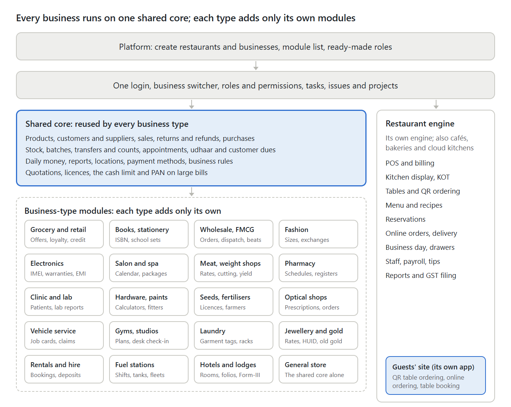

# Business Management Platform — product overview

For owners, management and prospective customers: what the product does for each type of business, what it does not do yet, and what management must decide.

## Summary

Business Admin, the staff application of the Business Management Platform, runs many kinds of independent business from a single login: restaurants and three food formats (café, bakery and cloud kitchen), shops and distributors, salons, pharmacies, clinics and diagnostic labs, and eleven more trades on the shared core: general stores, hardware and building materials, seeds and fertilisers, opticians, garages, jewellers, fuel stations, gyms and coaching, laundries, rentals, and hotels and lodges.

- **Who it is for:** owners, managers and staff of small and mid-sized Indian businesses, including chains with several branches and kitchens that sell under several brands.
- **What it covers:** selling, buying, stock, customer credit, staff and access, daily money, reports and daily tasks, plus the special work of each business type.
- **Where it stands:** the admin side and the guests' site are built and tested end to end. They have not yet run in a live business.
- **Not built yet:**
  - outside connections: payment gateway, SMS and WhatsApp, live Swiggy and Zomato links, maps;
  - hardware links: silent printing, scales;
  - paid plans, separate mobile apps, and going live on a server.

  These wait on decisions and outside accounts. [What comes next](#what-comes-next) sums them up, and [BACKLOG.md](BACKLOG.md) lists them in full.

## How it is organised

One application serves twenty-three business types:

| Group | Business types |
| --- | --- |
| Food | Restaurant |
| Shops | Grocery / kirana, supermarket, books and stationery, general store and other shops |
| Trade | Wholesale / FMCG |
| Speciality retail | Fashion, electronics, optical shops, jewellery and gold |
| Building and farm | Hardware, paints and building materials; seeds, fertilisers and pesticides |
| Vehicles and fuel | Vehicle service and auto parts, fuel stations |
| Services | Salon and spa; gyms, studios and coaching; laundry and dry cleaning; rentals and hire |
| Stays | Hotels, lodges and guest houses |
| Health | Pharmacy, clinics and labs |
| Weight-based | Meat and seafood, other weight-based shops |

A restaurant also chooses its format: **restaurant, café, bakery or cloud kitchen**. A business's type is fixed when it is created and decides which screens and rules it gets.

Read the diagram top to bottom:
1. The platform sets up restaurants and businesses.
2. One login opens every business a person belongs to.
3. The shared core does the common work.
4. Each business type adds only its own modules.

The restaurant and its formats run their own engine, with roles of their own, but share the login, the switcher and tasks. Guests never sign in: table QR ordering, online ordering and table booking open on the separate guests' site. The diagram's source is `images/business-admin-overview.html`: edit the words there and render it again.

## The shared core

Every business except the restaurant runs on the same core. It is built once, so a fix or improvement reaches every business type at the same time.

| Area | Module | What it does |
| --- | --- | --- |
| Overview | Overview | Today's sales against the same day last week, a 14-day trend, sales by hour, best sellers, money in, what customers and suppliers are owed, low stock, expiring batches, the next appointments and the jobs needing attention; every action opens in a panel |
| Sell | Sales / Quick bill | Barcode or scale-label billing, branch and member prices, coupons, cashier shifts; cash, UPI, card or udhaar; A4 GST invoice or till receipt |
| Sell | Quotations | Estimates at today's prices with a date they hold until; revised, printed on A4 or sent on WhatsApp; once the customer agrees, billed (or made into a sales order) at the quoted prices |
| Sell | Returns and refunds | Goods back against the original bill, each return and refund numbered, stock back automatically |
| Sell | Customers and udhaar | GSTIN, credit limit and days, what each owes, ageing, reminders, numbered collection receipts |
| Buy | Purchases and suppliers | Supplier bills with free quantity and discount, purchase orders, reorder suggestions, supplier payments and statements |
| Products | Products, categories, units | GST rate, HSN, MRP, shelf location, member price, departments, batch / expiry / serial tracking, pack sizes, opening stock when an item is added |
| Stock | Stock, transfers, counts | Stock by branch and batch with its value; transfers in transit; counts approved before stock changes |
| Time | Appointments | Staff and rooms without double booking; done, no-show and cancel rules |
| Money | Daily money and expenses | Takings by method, person and counter matched with cash, with a cash check and each cashier's shift; expenses paid out, corrected only by a reversal with a reason |
| Settings | Business settings | Legal name, GSTIN, address, tax mode, rounding, financial year, opening hours, rules, number series, payment methods |
| Settings | Licences & registrations | Each branch's licences and registrations with their numbers, issuing authority and dates; the bell warns 60 days before one runs out |
| People | Staff and access | Role, branch and department for each person |
| Insight | Reports and activity log | Money by day, branch comparison, department sales, and who did what |

Two rules hold everywhere:
- Prices, tax and totals are always worked out by the server.
- Nothing posted is ever edited. A mistake is corrected by a return, refund or reasoned correction with its own number.

## What each business type gets

Each business type adds only what is truly its own on top of the shared core. The restaurant is the exception: it runs its own complete engine, shared by its formats.

**Getting products in.** A restaurant imports its menu, recipes, stock items, suppliers and guests from CSV files. The other business types have no file import: their products, customers and suppliers are entered on screen. A new item can take the stock already on the shelf as opening stock; further stock comes in through purchases.

### Restaurant, café, bakery and cloud kitchen

- **POS:**
  - dine-in, takeaway and delivery orders;
  - one bill paid in several ways;
  - a UPI QR for the exact amount;
  - the kinds of order offered depend on the format.
- **Kitchen display and KOT:** orders reach the right kitchen station; dishes can be marked sold out.
- **Tables and QR ordering:** floors and tables, guest QR ordering, captain sections.
- **Reservations and online booking:** bookings, the waitlist, and the restaurant's own booking page.
- **Online ordering and delivery:**
  - the restaurant's own ordering page and pickup tokens;
  - riders and rider cash;
  - Swiggy and Zomato channels with channel prices and commission (their orders are typed in).
- **Menu:** dishes, modifiers, combos, happy-hour prices, and recipes that drive stock use.
- **Back office:**
  - the business day, opened before service and closed after;
  - cash drawers, X and Z reports;
  - stock and purchasing, expenses;
  - staff attendance, payroll and tips;
  - guest loyalty;
  - sales, accounts and control reports, including GST filing, profit and loss and the Tally day book.

| Format | How it is set up |
| --- | --- |
| Restaurant | Tables, captains and the kitchen; dine-in, takeaway and delivery |
| Café | Order and pay at the counter with a token number to collect; a few tables; pre-orders for parties |
| Bakery | Takeaway and delivery; bakes made each morning from recipes; cookies and sweets sold by weight (price per kg); cake pre-orders with the message, an advance, a bake list and hand-over billing; the day-end unsold count written off at cost |
| Cloud kitchen | Delivery first, takeaway too, with no tables. Several brands from one kitchen: each brand has its own menu, prints on its KOT and bill, and has its own sales by channel net of commission |

### Grocery / kirana and supermarket

- **Quick bill:** barcodes, weighing-scale labels, quick weight buttons, coupons, member and branch prices, cashier shifts.
- **Offers and loyalty:** % or ₹ off an item or the whole bill, % off a category, and buy X get Y; the offer worth most to the customer applies by itself. Points are earned and redeemed.
- **Departments:** staff tied to a department, and a department sales report.
- **Udhaar book, labels and near expiry:** who owes what, label sheets, batches about to expire.

### Books and stationery

- **ISBN billing:** a wrong check digit is caught.
- **School sets and book orders.**

### Wholesale / FMCG distribution

- **Sales orders, dispatch and back-orders:** pick list, van load sheet, delivery challan.
- **Routes and beats, cheques and credit hold.**
- **Price groups, schemes and purchase orders.**

### Fashion

- **Size × colour grid:** each size and colour has its own barcode and stock.
- **Exchanges and credit vouchers, markdowns.**
- **GST by price:** applied automatically.
- **Garment tags and size curves.**

### Electronics and mobiles

- **IMEI / serial register.**
- **Warranties, repairs, EMI and financiers.**
- **Kits and bundles.**

### Salon and spa

- **Calendar:** a column per stylist and room, with deposits and fair no-show charges.
- **Bill:** services and products in separate tabs by category; products kept for salon use cannot be sold.
- **Packages, memberships, commissions and schedules.**

### Meat, seafood and weight-based shops

- **Selling by weight and daily rates.**
- **Cutting and yield:** true cost per usable kg.
- **Wastage and yield by supplier.**

### Pharmacy

- **Drug master and prescription sale:** first-to-expire batch, substitutes by salt.
- **Schedule rules and registers:** H, H1 and X, ready for inspection.
- **Expiry returns and recalls.**

### Clinics and diagnostic labs

- **Today's patients and the token queue:**
  - each patient gets a token on arrival, and priority patients are called first;
  - the doctor calls the next patient and starts the consultation from the token;
  - a full-screen board shows the waiting room who is being seen.
- **Doctors:**
  - consultation fee, plus a reduced or free follow-up within a set number of days;
  - OPD timings by weekday, with morning and evening sessions and leave;
  - appointments are booked only into a doctor's free slots;
  - the bill picks the right fee;
  - an earnings report shows each doctor's patients, fees and share.
- **Patients and consent, consultations:** registration with recorded consent; vitals, diagnosis, prescription and follow-up (doctors only).
- **Lab:**
  - orders, sample barcodes, results and pathologist approval;
  - amended reports keep every signed version and print as "amended", with the reason; older versions print as "superseded";
  - quality control: each morning's control runs are judged by the standard Westgard rules, a failed control holds that test's reports until QC passes again, and a chart shows the control's trend.

Pharmacy and clinic rules follow standard Indian practice. A pharmacist, a doctor and a legal adviser should review them before real use; [BUSINESS_RULES.md › Pharmacy, clinic and lab](BUSINESS_RULES.md#pharmacy-clinic-and-lab) sets them out.

### Hardware, paints and building materials

- **Quotations for a site:** priced exactly as the bill will be, valid until a date, revised while open, printed or sent on WhatsApp, then billed (or made into a sales order delivered in parts) at the quoted prices.
- **Sites:** each contractor's and builder's sites; bills, quotations and orders go to a site, and each site has its own ledger and dues to send on WhatsApp.
- **Today's rates:** the items whose price moves every day (cement, steel, pipes, cable) on one board: the morning's rates typed and saved together, within each item's MRP, used by bills at once and shared on WhatsApp.
- **Tile & paint calculators:** on Quick bill and in a quotation: the boxes of tiles an area needs with its wastage, and the litres and tins of paint for an area and its coats, added to the bill in one click.
- **Fitters' commission:** the painters, plumbers, electricians, masons and carpenters who bring customers are named on their bills; each bill's commission is worked out to the paisa by the shop's rules and kept with it, returns take it back, payouts go through the expense book (with a UPI app link), and each fitter has a statement to send on WhatsApp and a line in the commission report.

### Seeds, fertilisers and pesticides

- **Licences at the counter:** each branch's fertiliser, seed and insecticide licences with their numbers and dates; a fertiliser, seed or pesticide is billed only where a licence in force covers it, and the bill prints the licence numbers.
- **Banned and restricted molecules:** each pesticide keeps its active molecules; a banned one is refused on the item and at the counter, and a molecule barred on some crops is sold only once the farmer's crop is known, never for a barred one. Each entry on the list names the government order behind it.
- **Seed lots:** each lot comes in with its validity date and is never sold after it.
- **Subsidised fertiliser:** each bag sold carries the receipt number from the government's PoS device; a daily report sets the bags and receipts against the PoS device's stock, typed in, and the shop's own.
- **Farmers and season credit:** each farmer's village, father's or husband's name, land, crops and Agri Stack Farmer ID (never an Aadhaar number); dues by village; a credit bill for the kharif, rabi or zaid season falls due at the harvest date given.
- **Registers:** the daily stock and price board to print, the month's seed stock return in quintals and the insecticide sale register, all worked out from the bills and the stock.

### Optical shops

- **Prescriptions:** each customer's eye tests, typed per eye for distance, intermediate and near (SPH, CYL, AXIS, ADD, prism and visual acuity), with who examined (one of the shop's optometrists, or an outside doctor or optometrist with their registration number), the PD and the day the prescription is valid until. Every test is kept: a customer's history sets them side by side with how each power moved. Once spectacles are ordered on a prescription, it never changes.
- **Spectacle orders:** the job card holds the prescription, the frame (from stock, or the customer's own), each lens (its type, index, material, coatings, tint and brand), each eye's fitting PD and height, where it is made (the shop's workshop or a lab, with the lab's order number) and the day promised. It is priced exactly as the bill will be, and an advance goes on a numbered receipt. Each order goes through the lab or the workshop and a quality check, passed or failed by an optometrist or a manager, before it is ready; the job card for the lab prints the prescription and no prices. Delivery posts the bill at the booked prices, with the advance taken off. The daily screen shows the orders due today, ready to collect and overdue, and messages go to the customer on WhatsApp.
- **Remakes:** a new order linked to the delivered one, with why it is made again and who bears the cost; the customer pays nothing unless it is them.
- **The recall list:** the customers due for an eye test (12 months after their last unless the shop sets another interval), with their phone and a reminder ready on WhatsApp; each reminder given is kept.
- **Contact lenses:** with Variants on, a lens product's powers are made in one go, one item for each power of the range, each with its own stock.

The GST rates of an optical shop's goods and how to set it up: [ADMIN_GUIDE.md › Optical shops](ADMIN_GUIDE.md#optical-shops).

### Vehicle service and auto parts

- **Vehicles:** each customer's vehicles by their registration number, found however it is typed, with make, model, fuel, and chassis and engine numbers; every owner a vehicle has had; and an odometer log where a reading lower than the last needs a manager's approval and the reason. A customer with many vehicles (a fleet) gets one statement of the jobs on each.
- **Job cards:** a vehicle's visit from its arrival to its delivery: the reading and fuel in, what the customer says, inspection notes, the bay, the promised time and the mechanics. The estimate of parts, labour and outside work is priced exactly as the bill will be and kept in versions; the owner's approval records who gave it, how (in person, by phone or on WhatsApp) and when, and work that comes to more goes back to them. The board shows every vehicle in the workshop by where its job stands; a mechanic sees the job cards assigned to them, records the work done and the parts used, and sees no money. The customer copy prints the estimate to sign, and the workshop copy the work without prices.
- **Billing and insurance claims:** the job is billed at the job card's prices, with the advance taken off; the parts leave stock then. On a cashless insurance claim the insurer is billed for exactly what it approved and the owner for the rest (the deductible, the depreciation and what was not allowed), as CBIC Circular 217/11/2024-GST describes, and the two bills add up to the job to the paisa; on a reimbursement claim the owner is billed for the whole job.
- **Service reminders:** the next service by date and by kilometres, set at each bill (6 months or 5,000 km unless the garage sets others), and a service-due list that projects each vehicle's reading from how far it runs in a day, with insurance and PUC running out; reminders go on WhatsApp and are kept.

The GST rates of a garage's parts and labour and how to set it up: [ADMIN_GUIDE.md › Vehicle service & auto parts](ADMIN_GUIDE.md#vehicle-service--auto-parts).

### Gyms, studios and coaching

- **Plans:** by days or months, a pack of sessions, or sessions to use within a time; each sold as a service item of its own with its GST slab and SAC (5% without input tax credit for a gym, yoga or fitness centre; 18% for coaching and tuition, and for dance, music or art classes), a joining fee, how many days it may be frozen in how many freezes, grace days after it ends, whether it can be passed to another member, and a refund policy kept in versions.
- **Memberships:** sold on an ordinary bill, paid now or left on the member's dues, with the plan's terms and the policy version kept as sold; each member gets a code for their card. Renewals start the day after the last day; an upgrade credits the part not used against the new plan's bill; a freeze moves the last day on; a membership can be passed to another member when its plan allows it; and a cancellation gives back the part not used, by days or sessions, to the paisa, as a credit note and a refund that a manager approves with their PIN. The membership slip prints the member's code as a QR and the refund policy as sold.
- **Check-in:** the front desk types or scans the member's code, or finds them by name or phone, and sees at once whether they are let in, or why not: no membership, not started, over, frozen, no sessions left, or fees overdue for too long. A pack loses one session a day. A trainer checks members in and sees no money.
- **Fees in instalments:** a course fee split into instalments with their due days, adding up to the bill; each payment is a numbered receipt that covers them in order, and the overdue ones are listed. This way a coaching centre gives a receipt for every payment, keeps a course's fee as sold, and refunds the part not used when a student leaves.
- **Renewal calls:** memberships ending in the next 7 or 15 days and those ended in the last 30, with a WhatsApp message ready and every reminder kept.

The GST rates of a gym's, studio's or coaching centre's services and how to set it up: [ADMIN_GUIDE.md › Gyms, studios & coaching](ADMIN_GUIDE.md#gyms-studios--coaching).

### Laundry and dry cleaning

- **Price list:** each garment's price for each service (wash and fold, wash and iron, dry cleaning, steam press…), for each piece, pair or set or by the kilo; each service billed as a service item of its own with its GST slab and SAC (laundry, dry cleaning, pressing and dyeing at 18% with input tax credit); an express surcharge as a percentage on every garment.
- **Garment orders:** a fast intake screen at the counter: the customer, a tap for each garment, and for each its tag (the next number, or the one already on it), colour and brand, the defects seen, the customer's instructions, the risk explained to them and their acknowledgement, and a declared value; a bundle by the kilo is weighed and its pieces counted. The prices, the express surcharge and GST are worked out to the paisa and kept as taken in. The order receipt prints every garment with its tag, what was noted and the shop's terms, and a tag label prints for every piece.
- **The work and the racks:** each garment from received through the work to ready on a rack and slot, the order's status following its garments; any garment found by its tag, the customer's phone or the order number; WhatsApp messages ready for each step.
- **Billing and the handover:** billed when the garments are handed over (an advance taken at intake comes off first) or at intake, as the shop chooses; the garments are held until paid, for the whole order or for the garments handed over, unless the customer has an account with the shop. Cancelled garments are credited on their bill, with any money back approved by a manager's PIN.
- **Unclaimed and claims:** orders ready and not collected for the shop's days (30 to start with), with every reminder kept and nothing disposed of; damage claims decided by a manager: money back or a credit note up to the garment's charge, the work done again, or rejected.

The GST rate of a laundry's services and how to set it up: [ADMIN_GUIDE.md › Laundry & dry cleaning](ADMIN_GUIDE.md#laundry--dry-cleaning).

### Jewellery and gold

- **Today's rates:** a manager sets the day's selling rate per gram and old-metal rate for each purity (gold 24K, 22K, 18K and 14K; silver 999 and 925; platinum 950), morning or evening, from the shop's own reckoning, the association's or the IBJA rate; a sheet is never changed, and a bill takes the latest rate of its day.
- **Rate board:** the rates in large type for a screen in the showroom, read again every minute, and a message with the day's rates ready to send on WhatsApp.
- **Pieces & tags:** each piece a serial-numbered unit of its jewellery item in stock, its tag the number: gross, stone and net weight to the milligram, purity, wastage and making charge (per gram, a percentage of the metal or flat), stones (a man-made diamond always a laboratory-grown diamond), the BIS hallmark with its HUIDs and hallmarking charge; on approval with a customer or at the karigar and back, melted into the shop's own metal at its fine weight; tag labels with a barcode and the weights, never a price.
- **Jewellery bill:** scan or type each piece's tag or HUID: each is priced at the day's rate for its purity, with its wastage, making, stones and hallmarking, then 3% GST, rounded to the rupee; the HUID check refuses gold of 2 g or more without its HUID where hallmarking is mandatory (with the exemptions BIS lists, and the owner's say on each location's district and the turnover); the invoice prints each article's description, net weight, purity in carat and fineness, hallmarking charge and HUID, and the purity statement BIS asks for; the cash limit and PAN rule of every bill apply.
- **Old gold:** gold, silver and platinum bought from customers or taken in exchange, on a numbered voucher with the photo ID seen, the PAN or Form 97 over ₹2,00,000 and the seller's declaration: each article tested (karatmeter, touchstone, acid, fire assay), weighed to the milligram and valued at the day's buy rate by the fineness found, less the deduction; paid out by UPI or bank transfer (cash stays under ₹2,00,000 to a seller in a day, with any lower limit of the shop's own) and written in the expense book, or used on the customer's jewellery bill as a payment by old gold; a returned bill's old gold goes back on its voucher; the metal joins the shop's own by purity in grams and fine grams; a printed voucher for the seller to sign.
- **Gold schemes:** plans of up to 11 monthly instalments with a discount (never interest) when every instalment is paid; a customer joins with the plan's terms, a nominee and the first instalment; each instalment a receipt with its passbook and WhatsApp reminders; redeemed on a jewellery bill within the year (all that was paid, with the discount off the pieces before GST); stopped with a manager's approval, never paid back in money; the money held for schemes, for the accountant; the bell before the day-364 close.
- **Cash report:** each customer's cash with the shop (bills, receipts, scheme instalments, refunds, old gold paid out) in the month to today, customers sharing a PAN as one, flagged at ₹10 lakh (when a jeweller becomes a PMLA reporting entity) and at the shop's own level; the monthly cash transactions worksheet with its 15th-of-the-month due day, exported for the shop's officer; nothing is filed.
- **Precious-goods GST:** a jeweller starts with 3% as its default slab, with 0.25%, 1.5%, 5%, 18% and nil beside it, prices before GST rounded to the rupee, grams and carats among its units, and a Karigar / goldsmith role that sees the pieces without prices.

How to set a jeweller up: [ADMIN_GUIDE.md › Jewellery & gold](ADMIN_GUIDE.md#jewellery--gold).

### Rentals and hire

- **Rental items:** each thing hired out (a generator, chairs, a sound system, a car) billed as a service item of its own at the GST slab of the like goods, hired one by one (each unit with its registration or serial number and its meter) or from a pool of how many the shop has; a deposit for each one; rates by the hour, day, week and month, the cheapest mix charged for the hours booked; a minimum hire, a turnaround time between hires, and a late fee after a grace time; a vehicle self-drive or with the shop's driver.
- **Bookings and availability:** quotes and bookings on the shop's clock, each unit or piece held from its out time to its due back time and the turnaround time, and never booked twice, even when two counters book at the same moment; a board of what is overdue, due back today, out, reserved and quoted; the week by unit and pool; WhatsApp messages ready for the booking, the due back reminder and a late return.
- **The handover:** the hirer's photo ID (of an Aadhaar only the last four digits), each item's condition, meter and fuel; for a self-drive vehicle the hirer's driving licence and its date (refused once run out) and the State Transport Authority's licence; the deposit asked, or less with a manager's say-so; a handover slip for the hirer to sign.
- **The return and the bill:** all at once or in parts, with damage, missing, cleaning and fuel charges; the late fee by the hour or day; one GST bill through the core when the last of it is back, the advance and then the deposit paying it, the rest of the deposit handed back with a manager's PIN; cancellation charges billed the same way.
- **Deposits held:** each booking's deposit collected, applied to its bill, handed back and held, kept apart from sales, and what the shop holds in all.

How to set a rental business up: [ADMIN_GUIDE.md › Rentals & hire](ADMIN_GUIDE.md#rentals--hire).

### Fuel stations

- **The dealer's back office, never the forecourt:** readings, dips and densities are typed in; the dispensers, forecourt controllers and tank gauges stay with the oil company. Lubricants and the shop's items bill at *Quick bill* with their own GST.
- **Fuels, tanks and pumps:** petrol, diesel and CNG on the GST nil slab, each fuel bill line saying the price includes state VAT; tanks with their stock; dispensing units with their Weights & Measures stamping and their nozzles; the stamped 5-litre measure; the price in force at each outlet from the time it takes effect.
- **Shifts and the attendant's settlement:** each attendant's shift opened from the nozzles' totalisers and closed with the readings, the 5-litre test pumped back, the credit slips of fleet vehicles, the UPI, card and fleet-card takings and the cash; the meters' litres at the price exact to the paisa, the attendant short or in excess, posted through the core as fuel bills; a closed shift reopened only by a manager, with a reason, before the next one starts.
- **Tanks and registers:** the morning dips; tanker loads checked against the invoice's density (±3.0 kg/m³) and dipped before and after decanting, bought through the core; the daily stock register against the oil companies' tolerance (4% of the dip, and the evaporation allowance) and the density register, with the bell for a day beyond the tolerance, a stamping falling due and a load accepted outside the density check.
- **Fleet credit:** fleet customers' vehicles with the fuel they take and the most in a fill, filled on signed slips at the shift's close, and each customer's month vehicle by vehicle; an oil company's fleet card taken as a payment method.

How to set a fuel station up: [ADMIN_GUIDE.md › Fuel stations](ADMIN_GUIDE.md#fuel-stations).

### Hotels, lodges and guest houses

- **Rooms and their status:** room types with their occupancy, extra beds and rates a night before GST (rack, weekend, extra adult, child, extra bed), and rooms that housekeeping marks clean or dirty, out of order and back, with every change kept; only a vacant clean room is given to a guest.
- **Reservations never booked twice:** walk-ins, phone bookings and OTA bookings typed in with their booking id, each night priced at its own rate with the GST slab its value decides (5% at ₹7,500 a night or less, 18% above), an agreed rate for an OTA or a company, an advance on account; a room never held by two stays over a night, and a room type never by more stays than it has rooms, even for two bookings saved at the same moment; a two-week calendar of the rooms.
- **Check-in with every occupant:** each adult and child recorded with the photo ID seen (only the last four digits of an Aadhaar), a foreign guest with their passport, visa or OCI card and travel; the registration card to sign; the guest register for the local police.
- **Form-III:** each foreign guest's arrival and departure report counted down from 24 hours, made on the FRRO portal and marked here with its acknowledgement, on the bell until it is marked.
- **The folio and the bill:** the night audit posting each room night once at its own slab, extras at their own slabs, voids by a manager; the check-out billing the folio through the core to the guest or to a company with its GSTIN, paid first by the advance and the deposit, the rest handed back with a manager's PIN; cancellation and no-show charges.

How to set a hotel, lodge or guest house up: [ADMIN_GUIDE.md › Hotels, lodges & guest houses](ADMIN_GUIDE.md#hotels-lodges--guest-houses).

### The newer trades

General stores, hardware and building-material shops, seeds and fertiliser shops, opticians, garages, jewellers, fuel stations, gyms and coaching centres, laundries, rental businesses, and hotels and lodges run on the shared core from their first day:

- **Their trade's units and GST:** bags, coils, sheets, feet and tonnes for hardware; packets and quintals for seeds and fertilisers; carats and a 3% default slab for a jeweller; room nights for a lodge; hire by the day.
- **Their trade's tools to switch on:** contractor rates and site orders with challans for hardware; dealer rates and batch tracking for seeds and pesticides; eye-test and service bookings for opticians and garages; personal-training bookings for gyms.
- **Their own checklists:** nozzle tests and density checks at a fuel station, room turnover and the guest register at a lodge, the day-end tally at a jeweller, and more.

Every one but the general store also has screens of its own, described above; what each still lacks is in [BACKLOG.md › New business types](BACKLOG.md#10-new-business-types).

## Several locations

A business can run several shops, counters, godowns, clinics or outlets. Each is kept separately, and the owner sees all of them together.

- **Each location has its own:**
  - stock;
  - bill numbers;
  - daily money and cash check;
  - branch prices;
  - opening hours;
  - address, phone, GSTIN and state, printed on its bills.
- **Staff tied to one branch:** they see, open and change only that branch's records. This covers bills, transfers, appointments, visits, lab orders, repairs, pre-orders and every list and report. Anything belonging to another branch is refused by the server.
- **The top-bar location picker:** an owner can look at one branch or all of them, and every list follows the choice.
- **Stock transfers:** sent by one branch and confirmed by the receiving one.
- **Locations compared report:** the branches side by side.
- **Pharmacy branches:** each holds its own drug licence numbers.
- **The restaurant:** has the same under the name "outlets". Each outlet opens and closes its own business day.

## People, roles and security

Every action needs two keys: the business must have that module switched on, and the person's role must allow the action. The server checks both on every request.

- **One login, many businesses**, each with its own role.
- **Ready-made roles:** Owner, Manager, Cashier / sales, Stock keeper, Accountant and Viewer in every business; a pharmacy adds a Pharmacist, a clinic adds a Doctor, a Lab technician and a Pathologist, an optical shop adds an Optometrist, and a garage adds a Mechanic. A restaurant has its own set: Restaurant Admin, Manager, Cashier, Captain / Waiter, Kitchen staff, Accountant, Store keeper and a Collection display for the pickup screen. An owner can add roles of their own, and a manager can never give more than they hold.
- **Staff logins with a branch and a department.**
- **Sign-in protection:** passwords never stored in readable form, two-step sign-in, lockout after repeated wrong attempts, PINs for shared tills, PIN sign-off for pathologists and pharmacists.
- **Data kept apart:** each business sees only its own data. The server checks it on every request, and the database refuses any record that points at another business's data.
- **Activity log:** a record of who did what; posted bills are never edited.
- **Clinical privacy:** only doctors (and the owner) see clinical notes, and every view is logged.

## What the owner decides

Business rules are settings the owner changes, not values fixed in the program. Each starts at a sensible value. The starting values of the everyday rules are in [ADMIN_GUIDE.md › Business settings › Rules](ADMIN_GUIDE.md#business-settings--rules).

| Setting | Where it is set |
| --- | --- |
| Payment methods: add, rename, reorder or switch off | Settings › Payment methods |
| How sales are worked out: prices with or without GST, rounding, the most discount at the counter, udhaar for walk-in customers, a PIN for every bill at a shared till | Settings › Business settings |
| Business tools: which parts of Business Admin the business uses | Settings › Business tools |
| Which batches count as expiring soon | Settings › Business settings › Rules; a pharmacy uses Pharmacy settings |
| How long a credit voucher can be spent | Settings › Business settings › Rules |
| Customer credit age groups: the columns of the outstanding and udhaar reports | Settings › Business settings › Rules |
| Quick weight buttons for loose goods | Settings › Business settings › Rules |
| Till receipt paper: 80 mm or 58 mm | Settings › Business settings › Rules |
| Day cut-off: when late-night work still belongs to the day before | A restaurant: the Business day screen (Cash rules). Other businesses: Settings › Business settings › Rules, where it applies to tasks |
| Currency and time zone | Settings › Business settings (the currency only until the first bill or purchase); a restaurant sets them in its own Settings |
| Doctor fees and OPD: each doctor's fee, follow-up rule, slot length, share, timings and leave | Doctors, fees & OPD (clinic) |
| Restaurant format, which sets the POS order types, token numbers and starting features | Chosen in Platform › Restaurants; changed later in the restaurant's Settings › Features |
| Restaurant features: pre-orders, brands, deliveries, reservations, QR ordering, loyalty, stock, payroll and more | The restaurant's Settings › Features |
| Restaurant alert lines: when the bell warns | The restaurant's Settings › Alerts and timings |

A few rules are fixed on purpose, such as the GST rules, the permission list and the PIN lockout; [BUSINESS_RULES.md › Fixed on purpose](BUSINESS_RULES.md#fixed-on-purpose) lists them with the reasons.

## Tasks, issues and projects

Every business, restaurant included, gets the same tools for the team's daily work, designed for the phone.

- **My tasks and checklists:** ready-made templates (opening, closing, cleaning and more), recurring tasks, a team board, a calendar and compliance reports.
- **Issues:** raised, assigned, fixed and closed. An out-of-range reading on a checklist can raise one by itself.
- **Projects:** with milestones and task lists, from a blank page or a ready-made plan.

A restaurant starts with these tools on. Any other business switches them on in Settings › Business tools when it wants them. Tasks is marked as recommended for clinics, pharmacies and supermarkets, and Issues for pharmacies and supermarkets.

## Reports

Every list can be searched, paged and exported, and lists of records can be filtered by date. Reports respect each person's role and branch.

- **Every business on the shared core:** Overview, money by day, Daily money, locations compared, outstanding and ageing, department sales, activity log.
- **Retail and wholesale:**
  - top sellers, slow movers, margin, stock value, offers given away;
  - by salesperson, route or customer.
- **Fashion, electronics and salon:** sizes and styles, warranties and repairs, service profitability, commissions.
- **Meat and weight shops:** yield and wastage.
- **Pharmacy, clinic and lab:**
  - H1 and X registers;
  - doctor earnings;
  - lab worklists, report versions and the QC history.
- **Restaurant and food formats:**
  - sales, accounts and control reports, including GST filing, profit and loss, the Tally day book and the Z report;
  - for the cloud kitchen, sales by brand and channel after aggregator commission.

## Setting up a new customer

The platform's own Super Admin creates a new customer's business in the Platform screens; its login is made when the platform is installed. Creating a business takes a few minutes. Filling it in is the owner's work.

- **Platform › Restaurants:** adds a restaurant with its owner's login (a Restaurant Admin). The platform team chooses the format: restaurant, café, bakery or cloud kitchen. The restaurant starts set up for that format, with its GST rates, settings, delivery channels and a kitchen station. The owner adds the menu, tables, staff, GSTIN and FSSAI number after signing in.
- **Platform › Businesses:** adds a business of any other type, with its legal details, first location and owner's login (a new login, or an existing one by its email). The owner signs in and finds it ready: roles, GST slabs, units, payment methods and the type's everyday business tools are set up.
- **Add a business:** an owner, or a restaurant's admin, can start another business of their own and becomes its owner.
- **Modules on demand:** each business switches modules on or off within what its type allows, in Settings › Business tools. This is ready to be tied to paid plans later.

The owner then enters products, prices, customers, suppliers and staff logins. Shops type these in; a restaurant can import its lists from CSV files. Handing a business over to a new owner is not built yet.

How the Platform screens work: [ADMIN_GUIDE.md › The first platform login and the platform screens](ADMIN_GUIDE.md#the-first-platform-login-and-the-platform-screens). What a new business fills in first: [ADMIN_GUIDE.md › First steps in a new business](ADMIN_GUIDE.md#first-steps-in-a-new-business).

## Safeguards

Automated tests cover the admin side and the guests' site; the integration tests and the browser tests each build a fresh database on every run. Real staff have not yet used the platform in a live business; a pilot comes first ([GO_LIVE.md](GO_LIVE.md)).

Where a mistake would lose money, stock or medical records, the database refuses it as well as the program. For example:
- a duplicate bill number;
- stock below zero in a shop (a restaurant bill never waits for stock: its stock may go below zero, and the stock screens then ask for a count);
- editing a posted bill, a signed lab report, a prescription that spectacles were ordered on, or a delivered job card;
- an odometer reading lower than a vehicle's last without a manager's approval;
- a banned pesticide on a bill, or, with Licences on, a fertiliser, seed or pesticide sold where the branch holds no licence in force;
- changing a QC run;
- a record that points at another business's data.

## What comes next

Most of the work left lies outside the admin application: going live on a server, outside services, hardware links, paid plans and separate apps. Each item waits on a decision or an account from management, such as a server budget, provider contracts, the printer and scale models, plan prices, or a pharmacist, a doctor and an accountant to review the rules. [BACKLOG.md › At a glance](BACKLOG.md#at-a-glance) lists every item with what it needs.

Recommended order:
1. Run a pilot first, with one restaurant (or café) and one shop ([GO_LIVE.md](GO_LIVE.md)).
2. Add the payment gateway and WhatsApp.
3. Add plans and pricing.
